# Family Office OS

**A wealth management platform for private bankers, built around an Investment Policy Statement and powered entirely by free public data.**

Most portfolio tools answer "what is this account worth?" Family Office OS answers the question a private banker actually gets asked: *is this family going to be okay?* It brings a household's whole financial life into one place (entities and trusts, investments, real estate, private holdings, debts, goals, taxes and heirs) and runs every number through a written investment policy, a goal-based Monte Carlo plan, stress tests and an estate projection.

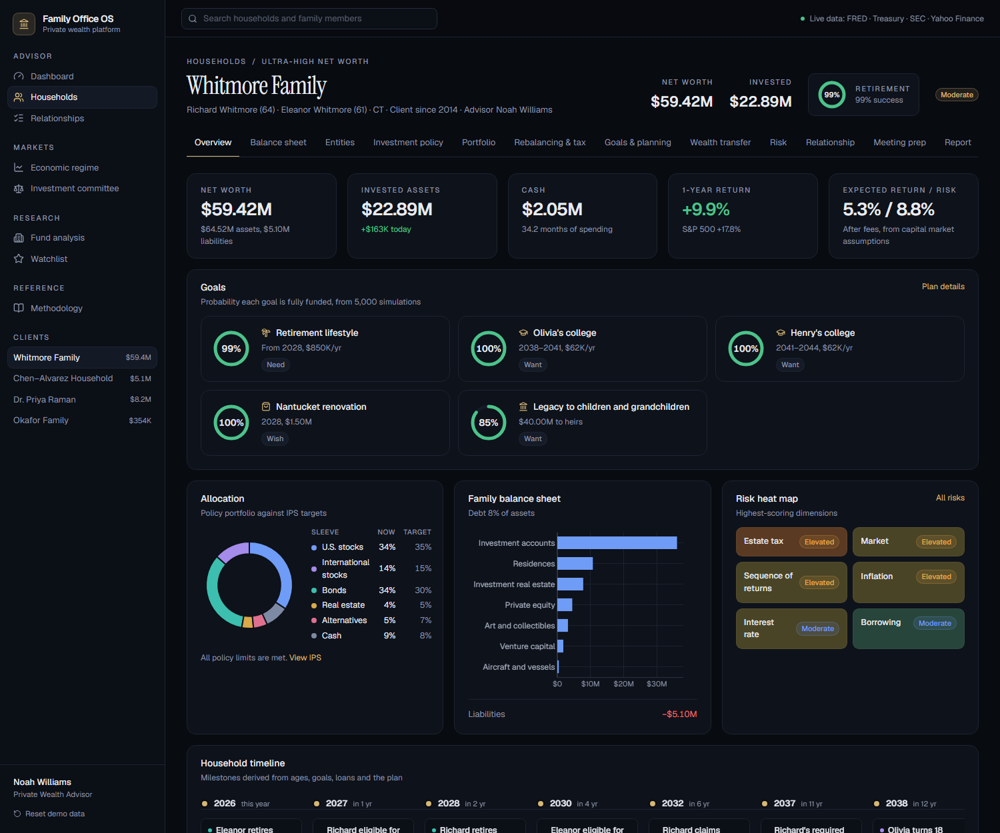

## At a glance

| | |
|---|---|
| **Scope** | 20 pages: an advisor dashboard, 12 tabs per household, a CRM, markets, research and methodology |
| **Code** | About 6,000 lines of TypeScript across 67 files, written from scratch |
| **Engines** | Goal-based Monte Carlo, IPS compliance, tax-aware rebalancing, asset location, tax-loss harvesting, Social Security, education, housing, estate transfer, risk profiling, historical stress replay, economic regime and an investment committee |
| **Data** | FRED, the U.S. Treasury, Yahoo Finance and SEC N-PORT, plus 2026 IRS, SSA and College Board figures checked against the official publications |
| **Speed** | 10,000 simulations in about 60 milliseconds, so plans recalculate as you type |
| **Cost to run** | $0: GitHub and Vercel's free tier, no database, no paid APIs, no AI model |
| **Documentation** | [Architecture](docs/ARCHITECTURE.md), [14 design decisions](docs/DECISIONS.md) and a [development log](docs/DEVLOG.md) |

## One family, end to end

Here is what the platform does with a single demo household. Michael Chen and Sofia Alvarez are two tech professionals with $5.1M, two children and 37% of their portfolio in NVDA from stock compensation:

1. **The investment policy flags it.** Live compliance shows NVDA at 36.7% against a 10% single-stock limit, U.S. equities 18 points over target, and a 2008-style loss of 47% against a 35% limit.
2. **The risk engine explains it.** NVDA carries 70% of the portfolio's risk with 37% of the money. The questionnaire scores the couple Aggressive on willingness but only Moderate on capacity, because their plan is just 62% funded.
3. **The plan quantifies it.** Their retire-at-55 goal has a 62% probability; toggling a market crash or a job loss shows how far it falls.
4. **The rebalancer fixes it, tax-aware.** It trims NVDA to the limit, diversifies into index funds within the same account, and estimates the cost: $807K of realized gains and about $192K of tax.
5. **The meeting brief raises it.** Before their next review, the platform drafts the agenda: readiness down from 81% at the last review, the drift, the breaches, contribution limits and the macro backdrop.
6. **The report documents it.** A multi-page PDF gives the family the same numbers.

Every step is a rule you can read in the code, applied to public data.

---

## Why this project exists

Wealth management software like Addepar, eMoney and Black Diamond costs thousands of dollars per advisor per year, and each covers only part of the job. I wanted to understand how the whole job fits together: how a family's goals become an investment policy, how the policy becomes an allocation, how the allocation is rebalanced tax-efficiently, and how all of it rolls up into a plan and eventually an estate.

The answer is this platform. It is my second project after [Intrinsic](https://github.com/btx-dysmas/intrinsic-terminal), an equity research terminal. Intrinsic shows I understand markets and valuation; Family Office OS shows I understand wealth management and private banking.

## Project timeline

| When | What happened |
|---|---|
| **2024** | First experiments in Visual Studio Code alongside Intrinsic: early portfolio and planning calculations |
| **October 23, 2025** | Started this version of the platform |
| **2026** | Rebuilt it around an Investment Policy Statement as a full-stack Next.js and TypeScript platform, and published it on GitHub and Vercel |

The [development log](docs/DEVLOG.md) covers how the current version was designed and built.

## Built around an Investment Policy Statement

Most student dashboards show numbers. Institutional investors start from governance: a written policy that sets objectives, risk limits, liquidity needs, spending rules and allocation ranges, which every later decision is measured against.

Every household here has a real IPS (objectives, risk tolerance, time horizon, liquidity, tax, legal, unique circumstances, strategic allocation with ranges and benchmarks, rebalancing, risk limits, spending policy, review and signatures), and the software is built around it:

- **Live compliance.** Every rule in the policy is checked against today's portfolio: allocation ranges, expected volatility, loss in the worst historical crisis, single-security concentration, cash reserve, illiquid share, expected return and review date.
- **Rebalancing** trades back to the policy targets, tax-aware and account-aware.
- **The risk questionnaire** feeds the policy's risk profile and targets.
- **The investment committee's** tactical tilts never leave a family's policy ranges.
- **Meeting briefs and client reports** lead with policy breaches.

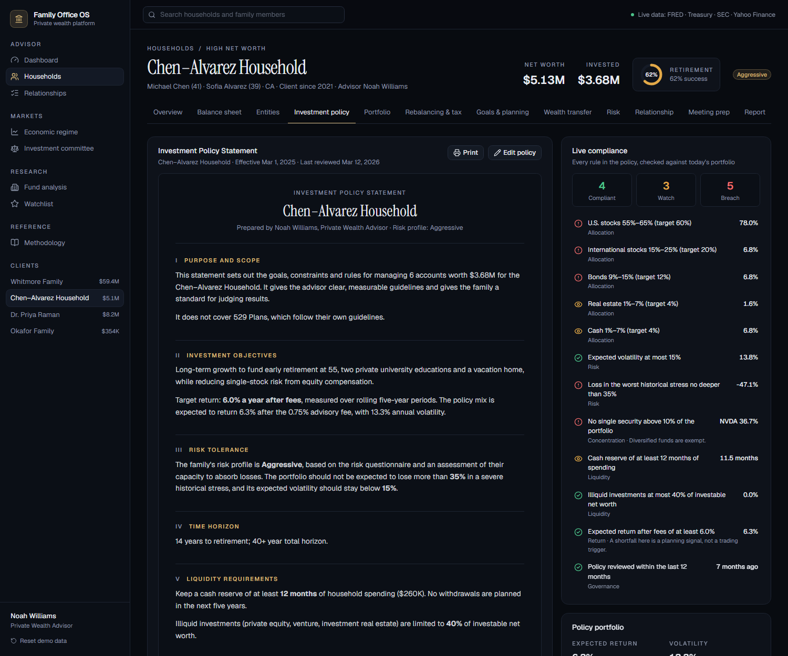

---

## What it does

| Area | Features |
|---|---|
| **Advisor dashboard** | Book-wide net worth, assets under advisement, cash, retirement probability, allocation, the economic regime, the yield curve and an attention queue (policy breaches, tasks, birthdays, meetings). |
| **Household balance sheet** | Accounts at live prices, real estate, private equity, venture, businesses, art and aircraft, liabilities, net worth, debt ratio and liquidity ratio. |
| **Entity structure** | Individuals, joint accounts, revocable and irrevocable trusts, LLCs, foundations, donor-advised funds, custodial accounts and 529 plans, drawn as an ownership tree with estate inclusion for each. |
| **Portfolio analytics** | Holdings, growth against the S&P 500, CAGR, standard and downside deviation, maximum drawdown, beta, Sharpe and Sortino ratios, rolling returns, performance and risk contribution, and fund look-through to sectors and underlying stocks. |
| **Portfolio builder** | Sliders for six asset classes showing expected return, volatility, Sharpe ratio and risk contribution, with one click to adopt the mix as IPS targets. |
| **Rebalancing and tax** | Concentration trimming, drift against ranges, trades that sell in tax-advantaged accounts and low-gain lots first, asset location optimization with estimated tax savings, and tax-loss harvesting with replacement funds. |
| **Goal-based planning** | Probability for every goal (retirement, education, home, purchases, legacy) from 1,000, 5,000 or 10,000 simulations, with fan charts, outcome distributions and worst and best cases. |
| **Life events** | Market crash, job loss, inflation spike, home purchase, new child, divorce and inheritance, each recalculating every goal against the base plan. |
| **Retirement engine** | Surplus or shortfall, withdrawal-rate analysis, Social Security benefits under the 2026 formula, education funding from College Board prices, and home affordability at today's mortgage rate. |
| **Wealth transfer** | Estate projection at the second death, federal estate tax, gifting, trust and charitable strategies, and a Sankey chart of where the estate goes. |
| **Risk** | A questionnaire scoring willingness and capacity, a ten-dimension risk heat map, historical stress tests (dot-com, 2008, COVID, 2022) and hypothetical shocks. |
| **Relationship CRM** | Activity log, tasks, birthdays, family members, preferences and last contact, per household and across the book. |
| **Meeting prep** | An agenda and discussion points generated from the numbers: progress since the last review, drift, breaches, harvesting opportunities, milestones and the macro backdrop. |
| **Client report** | A formatted multi-page PDF covering summary, goals, portfolio, risk, plan, compliance, economy and disclosures. |
| **Markets** | Economic regime classification with its history since 2008, and a rules-based investment committee with a tactical allocation for every household. |
| **Research** | Fund analysis with expense ratios, sectors, returns and complete holdings from SEC N-PORT filings, plus a watchlist with Treasury yields. |

## Screenshots

| | |
|---|---|
| 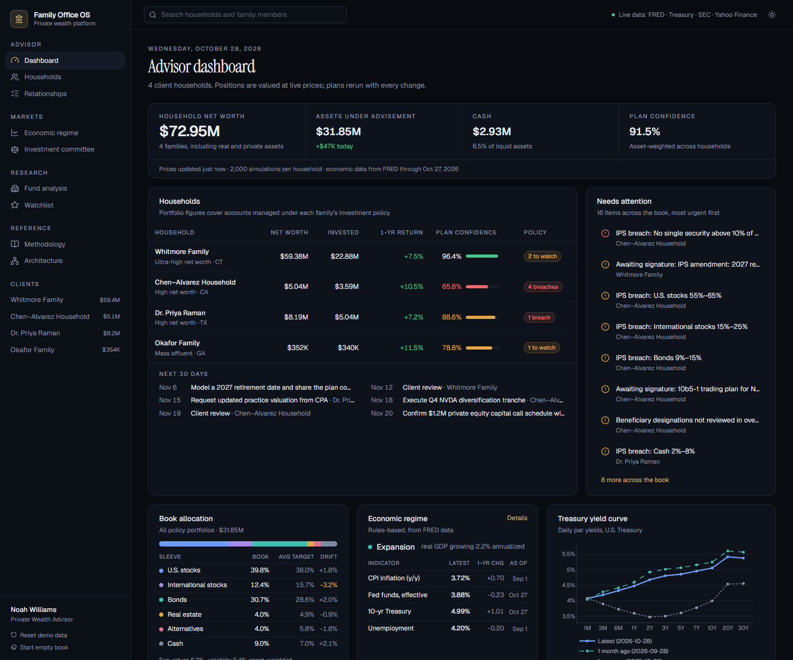 | 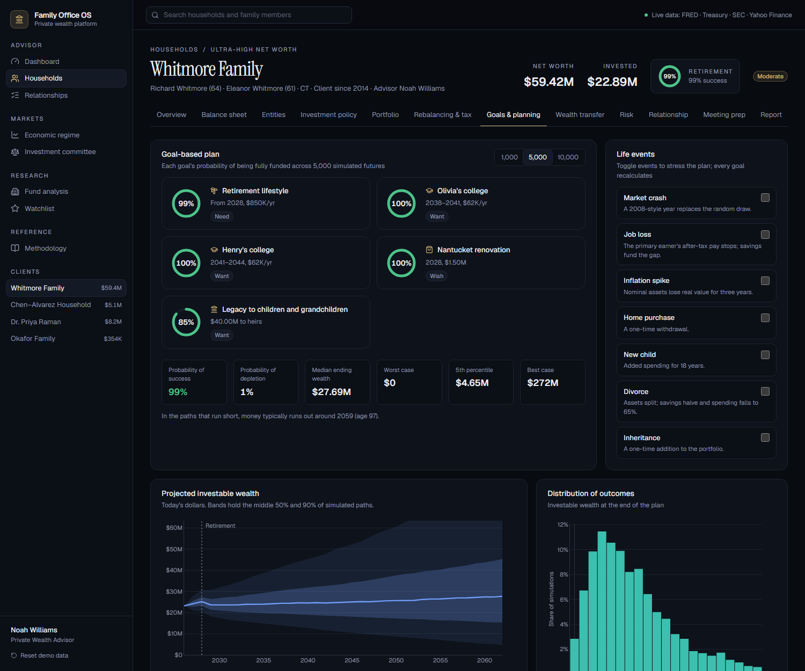 |
| **Advisor dashboard:** the whole book at a glance | **Goals and planning:** Monte Carlo with life events |
| 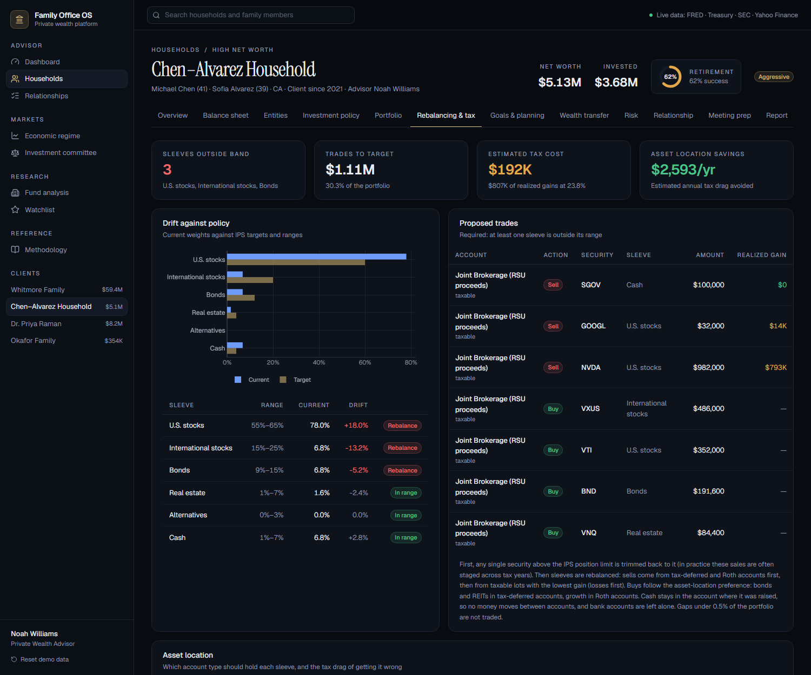 | 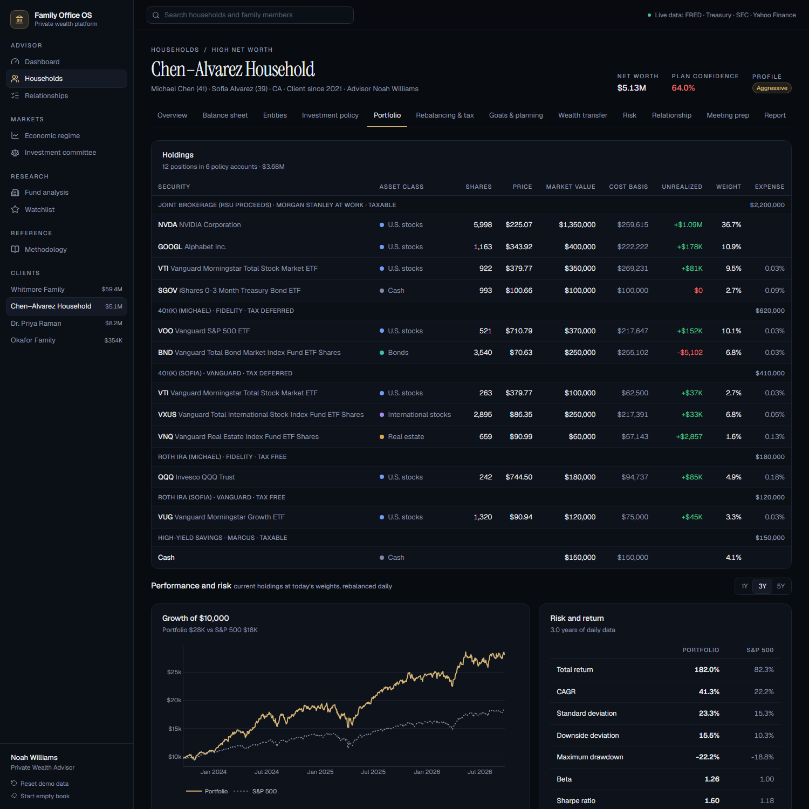 |
| **Rebalancing and tax:** trimming a concentrated NVDA position | **Portfolio analytics:** where the risk really comes from |
| 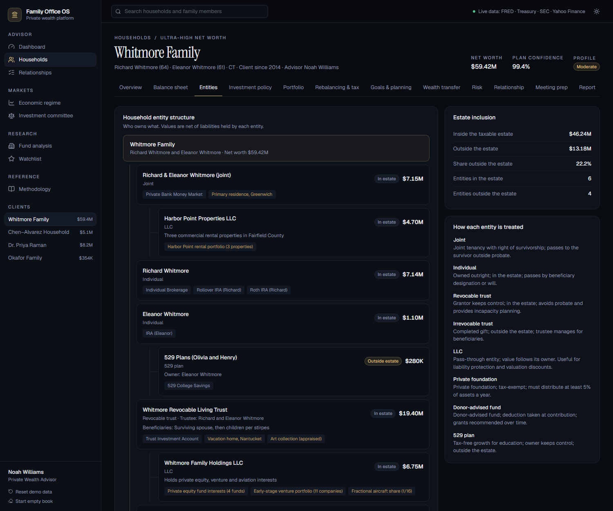 | 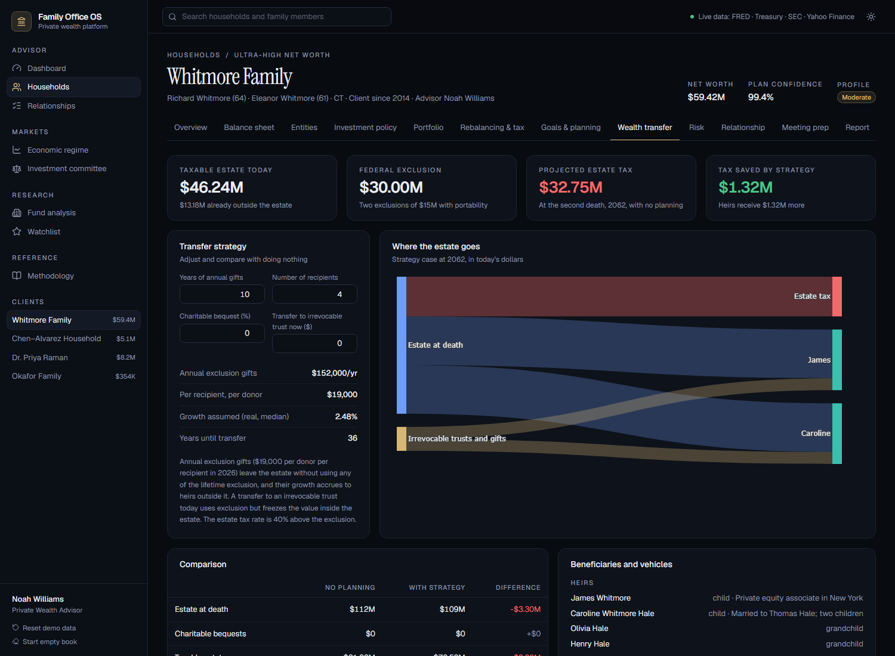 |
| **Entity structure:** trusts, LLCs and foundations | **Wealth transfer:** estate tax and transfer strategies |
| 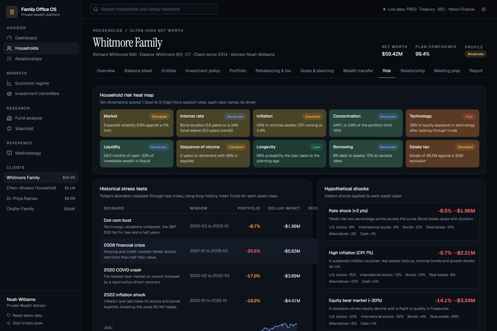 | 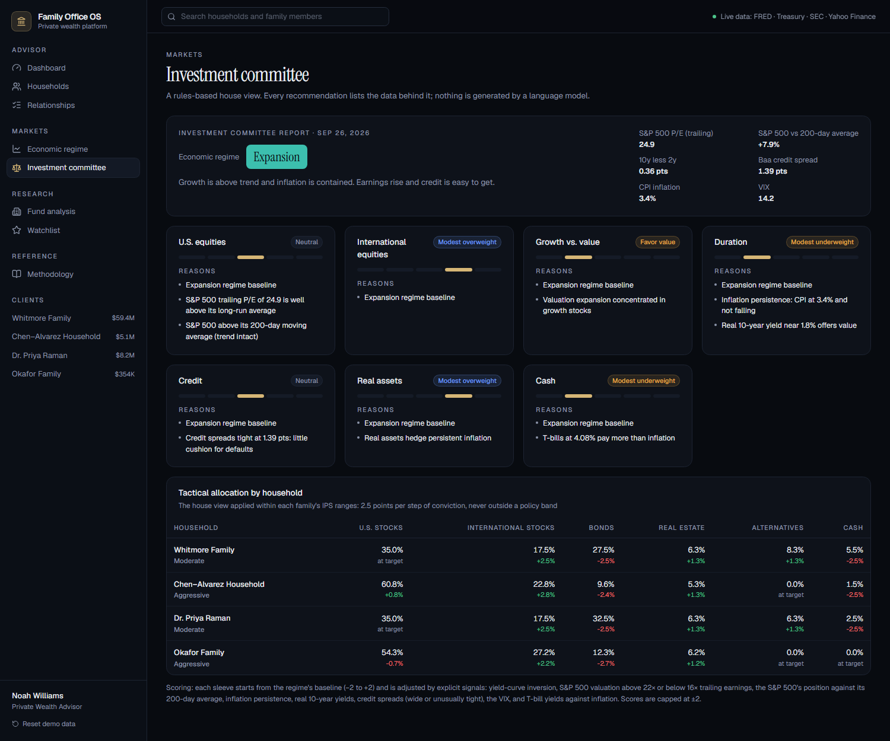 |
| **Risk:** heat map and historical stress tests | **Investment committee:** a rules-based house view |
| 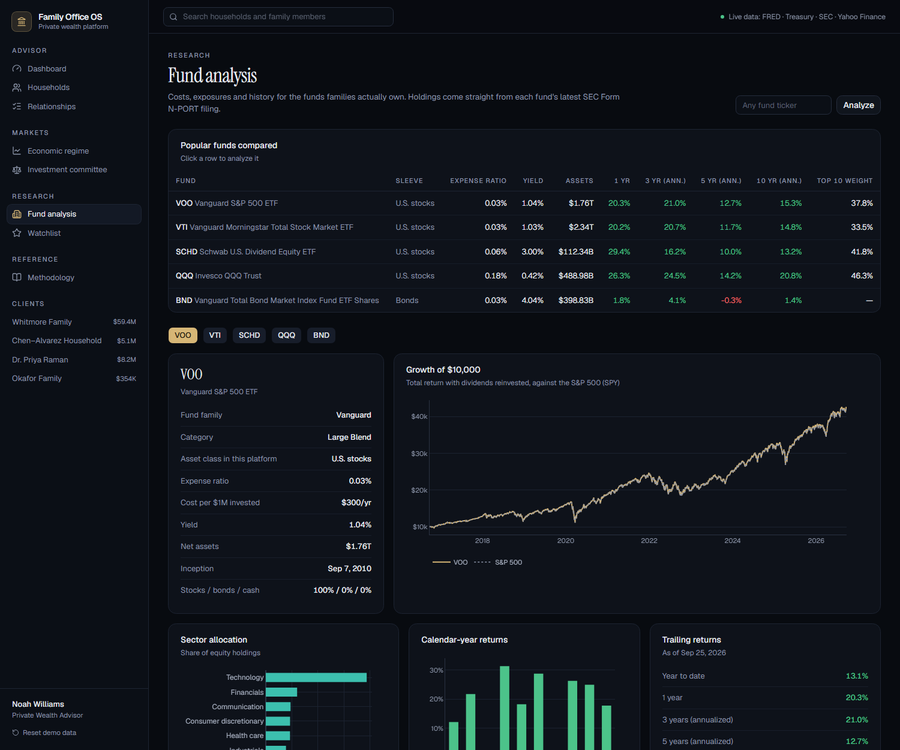 | 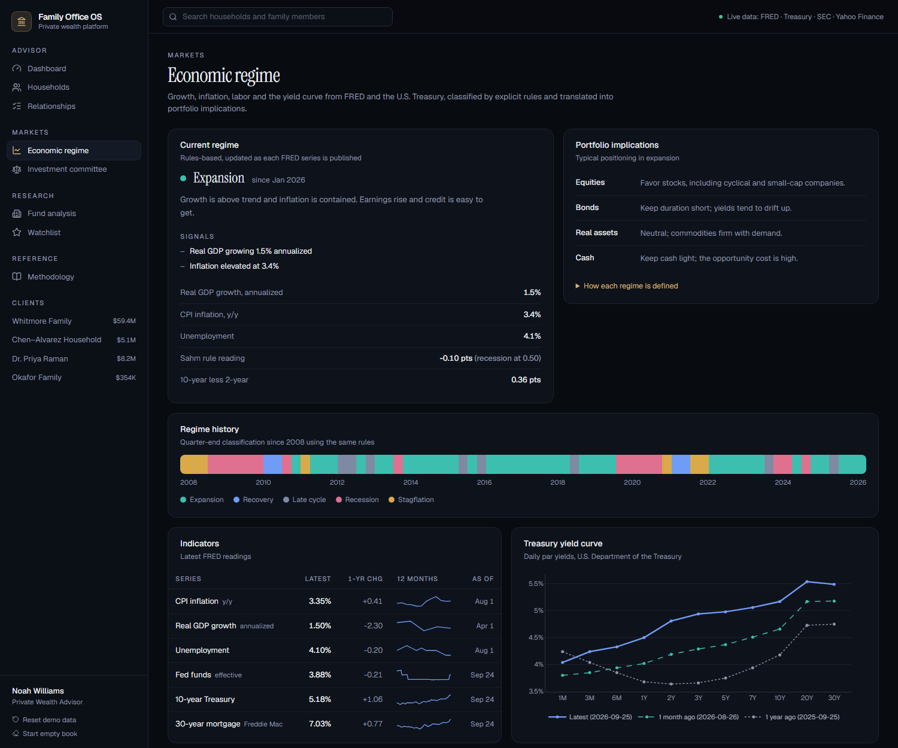 |
| **Fund analysis:** complete holdings from SEC N-PORT | **Economic regime:** FRED and Treasury data |

---

## Technical highlights

- **An executable IPS.** The policy statement is data, not a document: compliance, rebalancing, reports and meeting briefs all read their rules from it.
- **Goal-based Monte Carlo.** Up to 10,000 paths of lognormal returns in today's dollars, with cash flows paid in goal-priority order, federal tax gross-up on withdrawals and Social Security from the 2026 benefit formula. It runs in about 60 milliseconds, so the plan recalculates as you type.
- **Tax-aware rebalancing.** Concentration trimming first, then sells ordered by tax treatment and gain, and buys constrained to cash raised in the same account.
- **Asset location optimization.** Greedy placement by tax drag and expected growth, priced at the household's own marginal rates including the 3.8% net investment income tax.
- **Real historical stress tests.** Today's allocation replayed through four crises using long-history index mutual funds for each asset class, with recovery times.
- **SEC N-PORT parsing.** Ticker → series ID → latest filing → complete holdings, with asset-type and country breakdowns, for any registered fund.
- **Estate modeling.** Entity-aware estate inclusion, portability, annual exclusion gifts and trust transfers, compared with doing nothing.
- **No black boxes.** Commentary, meeting briefs and investment committee views come from explicit rules. The [methodology page](app/methodology/page.tsx) documents every formula.

## Architecture

```
Browser (Next.js App Router, React)
 ├── Household book in localStorage (four seeded demo families)
 ├── Planning engines: Monte Carlo, retirement, education, housing, estate
 ├── Policy engine: compliance, rebalancing, asset location, harvesting
 ├── Risk engine: questionnaire, heat map, stress replay
 └── Reports: jsPDF client review and meeting brief
 │
 ▼
Vercel CDN cache (s-maxage + stale-while-revalidate)
 │
 ▼
Next.js route handlers (TypeScript, serverless)
 ├── /api/quotes, /api/prices, /api/fund   → Yahoo Finance
 ├── /api/macro                            → FRED, U.S. Treasury yield curve
 ├── /api/nport                            → SEC EDGAR Form N-PORT
 └── /api/stress                           → long-history index funds (Yahoo)

Reference data (lib/reference.ts): IRS 2026 brackets and limits, SSA 2026 formula, College Board 2025–26 prices
```

### Design principles

**Transparency.** Every figure traces back to a public source, a stated assumption or a documented formula.

**Free data first.** Everything runs on public data and free infrastructure.

**Deterministic analysis.** The same inputs always produce the same plan, commentary and committee view.

**Governance before dashboards.** The investment policy comes first; the analytics serve it.

### Tech stack

| Layer | Tools |
|---|---|
| Framework | Next.js 16 (App Router), React 19, TypeScript |
| UI | Tailwind CSS 4, shadcn/ui (Base UI), Lucide icons, Geist and Instrument Serif |
| Charts | Plotly.js |
| PDF | jsPDF and jspdf-autotable |
| Hosting | Vercel (Hobby), GitHub |

### Data sources

| Source | Used for |
|---|---|
| **FRED** | Inflation, GDP, unemployment, Fed funds, Treasury and T-bill yields, mortgage rates, credit spreads, VIX |
| **U.S. Treasury** | Daily par yield curve |
| **Yahoo Finance** | Prices, fund expense ratios, sector weights, top holdings, trailing and calendar-year returns |
| **SEC EDGAR, Form N-PORT** | Complete fund holdings for look-through and research |
| **IRS** (Rev. Proc. 2025-32, Notice 2025-67) | 2026 tax brackets, capital gains thresholds, standard deduction, contribution limits, estate and gift exclusions |
| **Social Security Administration** | 2026 bend points, taxable maximum, claiming adjustments |
| **College Board** (Trends in College Pricing 2025) | 2025–26 published tuition and fees |

---

## Engineering constraints and lessons learned

Building a family-office platform with no budget shaped the architecture as much as the finance did. The trade-offs, each written up in [DECISIONS.md](docs/DECISIONS.md):

- **No database:** households live in the browser, so there is nothing to provision or pay for
- **No paid data:** public sources only, with official reference figures compiled in and checked each year
- **No language model:** meeting briefs and committee views come from deterministic rules
- **Serverless limits:** parallel fetching, CDN caching and fallbacks for filings too large to parse
- **Everything computed client-side,** which forced the engines to be fast enough to rerun on every keystroke

**No database, on purpose.** Households are stored in the browser so the whole platform runs on Vercel's free tier with nothing to provision. That makes it a single-advisor demo: a production version would add authentication and an encrypted database with per-client access controls. The data model in `lib/types.ts` is already shaped for that move.

**Published figures, hardcoded once a year.** Tax brackets, Social Security bend points and tuition averages change annually. Rather than scrape them, they live in one file with their sources, and every calculation reads from there. Each figure was checked against the official publication.

**Real stress tests needed long history.** Most ETFs didn't exist in 2000. The stress engine uses index mutual funds that did (Vanguard 500 Index, Total International, Total Bond Market, REIT Index, Short-Term Treasury) plus gold futures, so the dot-com and 2008 scenarios replay actual returns instead of guesses.

**The largest bond funds are too big to parse.** Vanguard Total Bond Market's N-PORT filing lists tens of thousands of positions. Rather than time out a serverless function, those funds fall back to their published top holdings, and the page says so.

**Rules over a language model.** Meeting briefs and the investment committee could have been written by an LLM. Rules turned out better for this domain: every sentence is backed by a number, nothing is invented, and it costs nothing to run.

## The work behind it

| Document | What's in it |
|---|---|
| [Architecture](docs/ARCHITECTURE.md) | Data model, the household model, the IPS engine, Monte Carlo, planning and tax, risk and stress testing, N-PORT parsing, caching and a module map |
| [Design decisions](docs/DECISIONS.md) | 14 decisions, each with its context, the alternatives and the consequences |
| [Development log](docs/DEVLOG.md) | Proving the data sources, building the engines, calibrating the demo, and the bugs found by reviewing every screen |

---

## Run it locally

You need Node.js 20 or newer.

```bash
git clone https://github.com/btx-dysmas/family-office-os.git
cd family-office-os
npm install
cp .env.example .env.local   # then fill in the two values
npm run dev
```

Open http://localhost:3000.

| Variable | Required | What it is |
|---|---|---|
| `FRED_API_KEY` | Recommended | Free key from [fred.stlouisfed.org](https://fred.stlouisfed.org/docs/api/api_key.html). Powers economic data, rates and the regime model. |
| `SEC_USER_AGENT` | Recommended | Your name and email, e.g. `Jane Doe jane@example.com`. The SEC requires it for N-PORT requests. |

## Deploy (free)

1. Push the repository to GitHub.
2. Import it at [vercel.com/new](https://vercel.com/new); the Next.js defaults are correct.
3. Add `FRED_API_KEY` and `SEC_USER_AGENT` under **Settings → Environment Variables**.

## Project structure

```
app/                       pages and API route handlers
  households/[id]/         overview, balance sheet, entities, policy, portfolio, rebalancing,
                           planning, estate, risk, relationship, meeting prep, report
  api/                     quotes, prices, fund, nport, macro, stress
components/                shell, UI kit, charts, household widgets
lib/                       domain logic
  types.ts, seed.ts        data model and demo households
  reference.ts, cma.ts     published figures and capital market assumptions
  household.ts, tax.ts     valuation, ratios, estate inclusion, taxes, Social Security
  montecarlo.ts            goal-based simulation and life events
  planning.ts              retirement gap, education, affordability, estate
  ips.ts, risk.ts          compliance, rebalancing, asset location, harvesting, risk scoring
  regime.ts, brief.ts      economic regime, investment committee, meeting prep
  server/                  Yahoo, FRED, Treasury, SEC N-PORT clients and caching
```

## Roadmap

- Authentication and a database for multi-advisor use
- SEC Form 4 alerts on clients' concentrated stock positions
- Required minimum distribution and Roth conversion planning
- State income and estate taxes
- Custodian data imports (CSV)

---

## Disclaimer

Family Office OS is an educational project. Households are fictional, and projections are hypothetical and not investment, tax or legal advice.

## Author

**Noah Williams** (Dysmas Anastasiou)
Email: nwfootball07@gmail.com
